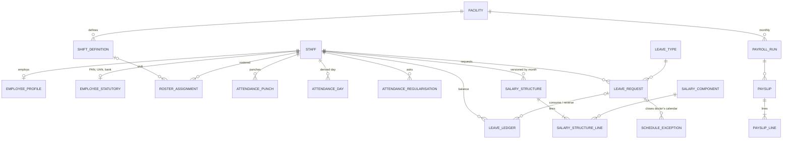

# M18 — HR: employment, attendance, leave, payroll (schema `hr`)

Added 2026-10-21 for the clinic operations modules ([CLINIC_OPERATIONS_MODULES.md](../../plan/CLINIC_OPERATIONS_MODULES.md)). `platform.staff` stays the identity (M01); HR adds employment, time and pay. Kept apart from M15 `operations` (work queues) because payroll and bank data are sensitive and have their own permissions.

| Table | Key columns | Rules |
|---|---|---|
| **employee_profile** | facility, designation, department, reporting_to, date_of_joining / exit, emergency contact, status (`active`,`on_notice`,`exited`) | 1:1 staff. Exit emits `employee.exited` → platform ends `staff.active_to` |
| **employee_statutory** | PAN, UAN, ESIC no., bank account + IFSC, PF / ESI applicable, PT state | Sensitive (`payroll.read`); no Aadhaar |
| **shift_definition** / **roster_assignment** | start/end local (overnight allowed), break, grace / staff, date, shift or week off | UQ staff+date |
| **attendance_punch** | punched_at, in/out, source (`self`,`manager`,`kiosk`), note | Append-only; manager punches need a note |
| **attendance_day** | status (`present`,`half_day`,`absent`,`paid_leave`,`unpaid_leave`,`holiday`,`week_off`), first in / last out, worked, late, source, is_locked | Derived from roster, leave, `booking.facility_holiday` and punches; frozen when the payroll month is locked |
| **attendance_regularisation** | date, requested status, reason, decision | Decided by someone else |
| **leave_type** / **leave_request** / **leave_ledger** | paid?, quota, carry-forward, allow negative / dates, half day, days, status / grant, consume, reverse, lapse, adjust | Balance = Σ ledger. No overlapping live requests (EXCLUDE). Consumed once (UQ). Approval by someone else |
| **salary_component** / **salary_structure(_line)** | earning/deduction, fixed or % of basic, prorate / effective month | One basic component; structures append-only |
| **payroll_setting** / **professional_tax_slab** | PF rate + wage ceiling, ESI rate + gross ceiling / state, gross range, amount | Values to confirm with the CA |
| **payroll_run** / **payslip** / **payslip_line** | month, status (`draft`→`computed`→`approved`→`paid`→`locked`) / paid days, LOP, gross, deductions, TDS, net, bank snapshot / snapshot lines | Approved payslips immutable; approver ≠ computer |
