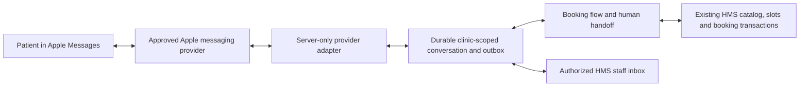

# Apple Messages for Business: implementation and provider decision

24 October 2026. Branch `codex/apple-messages-foundation`, based on main `2c773da`.
The user selected **Amazon Connect** after the comparison below. Apple Business
Register sign-in and service-terms acceptance are complete; the Messages account
application is at policy declarations and has not been submitted. AWS is not yet
provisioned. The local implementation and deployment package are available; cloud
deployment, provider acceptance and a physical iPhone test remain pending.

**New eligibility blocker, checked during registration on 24 October 2026:**
[Apple's channel policies](https://register.apple.com/resources/messages/messaging-documentation/policies)
say Apple is not onboarding businesses that primarily offer medical or health-related
services or products. Clinic eligibility must not be assumed. No exemption for a
software-company-owned synthetic internal test of this clinic use case was established.
The deployment guide contains a prepared, unsent clarification request; verify the
actual business and obtain Apple/MSP guidance before submission or paid provisioning.

## Current implementation

- Clinic-scoped Apple conversation storage, durable inbound deduplication and reply
  intents, with tenant RLS and permission checks on dashboard reads/replies.
- Rules-based consent, doctor/mode/time choices, name and unverified contact entry,
  explicit confirmation and the existing transactional HMS booking path. Appointment
  origin is `apple_messages`; price-list currency survives the signed slot and receipt.
- Reception handoff and dashboard replies; STOP cancels queued text even after a
  human takes over. Actual chat-ended / AWS agent-join transcript events close the
  session. Revoked staff permissions are checked again before outbound sending.
- Amazon Connect custom-participant bootstrap, private SNS → SQS wakeups, transcript
  reconciliation and SDK-based worker. Participant credentials remain server-side.
  Lost send responses reuse the outbound idempotency token; acknowledgements are
  called accepted, with no invented delivery/read state.
- A dedicated local USD demo clinic and dashboard, separate from the test database.
  The local smoke flow commits a real local appointment. It sends no Apple messages.
- Reviewable CloudFormation generator and account/deployment/iPhone acceptance guide:
  [infra/apple-connect/README.md](../../infra/apple-connect/README.md).

Migrations: `20261024090000_apple_messages_onboarding.sql` and
`20261024100000_apple_connect_booking.sql`. The dashboard lives at
`/staff/apple_messages`. Provider identifiers, AWS configuration and credentials
are not dashboard inputs or API response fields.

This is a bounded English, plain-text pilot. Native Apple time/list pickers,
Spanish automation, setup-hours/after-hours enforcement, automated rescheduling,
cancellation and proactive reminders remain unimplemented. The setup-request API
stores these preferences but does not activate a provider or enforce those rules.
The Apple setup preferences do not yet have their own dashboard editor. Clinic
staff can read conversations and queue replies through the dashboard; platform
operators provision the company-managed provider binding outside the clinic UI.
Full Arc appearance, keyboard and motion parity awaits the user's visual review.

## Setup request foundation

Apple setup preferences now use the existing company-managed onboarding API:

- `GET /v1/channel-onboarding/apple_messages?facilityId=<uuid>` reads the actual
  saved state, including `not_started` when there is no request.
- `PUT /v1/channel-onboarding/apple_messages` saves `{facilityId, version, draft}`.
- `POST /v1/channel-onboarding/apple_messages/submit` submits `{facilityId, version}`.

Writes require `comms.manage` for that facility; reads require `comms.read`.
Tenant isolation, optimistic versions, durable idempotency receipts, attributed
audit events and the existing `channel.setup_requested` outbox event are retained.
Saving/submitting never creates a provider binding or claims delivery or activation.
The response always has `live:false` and `activation:provider_verification_required`.
The event records a setup request; no new provider-provisioning consumer is included.

The Apple draft contains the clinic's brand name, HTTPS website, business phone,
support email, English/Spanish language choices, greeting, support time zone,
weekday support hours, after-hours message, on-request human handoff and the
applicant's declaration that they may represent the clinic. That declaration is
not Apple verification. Credentials and provider account IDs are not request fields.
Support hours cover one same-day interval per selected ISO weekday (Monday=1).
Split/overnight support schedules would need an explicit extension.

Migration: `db/migrations/20261024090000_apple_messages_onboarding.sql`.
It extends the existing channel constraint without changing WhatsApp contact points.
Rollback refuses to discard saved Apple requests.

The existing voice/WhatsApp form remains explicitly restricted to those channels.
The separate Apple inbox displays actual configuration/local-demo state rather
than treating a submitted setup request as an operational connection.

## Architecture and original implementation requirements

The numbered list below records the original design requirements. The implementation
above now covers their core booking/transport/storage paths; it does not establish
provider approval, every lifecycle event or the deferred experience features.

1. Provision one approved clinic brand in a test environment. Confirm how account
   IDs, clinic brands, webhook credentials and environment boundaries map. Use
   [Apple Messages for Business](https://developer.apple.com/imessage/), not a
   personal iMessage relay or a mandatory patient-installed iMessage extension.
2. Implement only the chosen provider's documented authentication, event types,
   delivery receipts and API. Verify the request before accepting content. Resolve
   the tenant/facility from a company-owned provider binding, never a body-supplied
   tenant ID. Deduplicate signed events and preserve conversation ordering.
3. Store opaque Apple/provider customer and conversation IDs separately from
   WhatsApp's E.164 contact-point model. A chat identity does not verify a supplied
   phone number, patient chart identity or consent for another messaging channel.
4. Extract the reusable department/doctor/mode/slot/name/confirmation transitions
   from `managed-booking-chat.ts`, retaining WhatsApp consent and sending rules in
   its adapter. Apple needs an explicit contact-details step. An LLM is optional.
5. Reuse `publicCatalog`, `publicSlots` and the booking transaction in
   `modules/booking/public-booking.ts`. Apple origin and persisted conversation
   confirmation proof are now implemented; do not bypass proof or label Apple
   bookings as WhatsApp.
6. Trace actual currency through the price list, signed slot, booking snapshot and
   receipt. Current chat copy hardcodes rupees; changing only the symbol to dollars
   would misrepresent a fee. Test +1 contact entry and US daylight saving boundaries.
7. Persist the committed booking receipt and durable reply intent with retry-safe
   linkage. A transport timeout must not create a second appointment; never send a
   confirmation for a failed or unresolved booking. Delivery status remains separate
   from appointment state. Patient confirmation precedes the booking command.
8. Add the HMS Apple inbox and setup/status controls with server-enforced facility
   permissions, staff takeover, after-hours expectations, blocked/deleted thread
   handling and notification preferences. Apple requires a live support option;
   do not offer a bot-only service. [Apple channel policies](https://register.apple.com/resources/business-chat/BC-Policies_and_Best_Practices.pdf)
   are still linked by the provider onboarding guide, but the PDF is dated 2020;
   reconfirm current terms at onboarding.

[Amazon's onboarding guide](https://docs.aws.amazon.com/connect/latest/adminguide/apple-messages-for-business.html)
describes brand registration, provider linking and experience review. Provider
approval and a real iPhone test remain separate from passing local application tests.

## Preliminary cost/benefit comparison

Public USD pricing checked 24 October 2026. These are budgeting scenarios, not a
quote for healthcare, independent clinic brands or a software resale arrangement.

| Criterion | Amazon Connect | Zendesk / Sunshine Conversations |
| --- | --- | --- |
| Pricing basis | Main Connect Customer plan lists third-party messaging at $0.014 per sent/received message. Customer Basic lists $0.010, but its availability to our new account needs confirmation. | Public Suite Professional price is $115 per agent/month, paid yearly. The Conversations API key documentation requires Professional or above. |
| Usage accounting | More messages and repeated visits increase usage charges. | MAU-based usage; repeated identifiable visits in one calendar month generally remain one MAU. Public pricing lists 1,000 included and $50 per extra 2,500 MAU pack. |
| Likely benefit for HMS | No seat-based licensing in the main plan; usage pricing is straightforward to model for a small pilot. | Programmable conversation APIs and richer support operations may become attractive as repeat engagement grows. |
| Engineering tradeoff | Requires AWS account/permissions, contact flows and transport integration; custom-inbox routing and takeover need a proof. | Requires API integration and switchboard/control handling; custom HMS inbox rights and required licensed seats need confirmation. |

Sources: [AWS main pricing](https://aws.amazon.com/products/connect/customer/pricing/),
[AWS pricing appendix](https://aws.amazon.com/products/connect/customer/pricing/appendix/),
[Zendesk plans](https://www.zendesk.com/pricing/),
[Conversations API access](https://support.zendesk.com/hc/en-us/articles/4576088682266-Using-Conversations-API-keys),
[MAU accounting](https://support.zendesk.com/hc/en-us/articles/6546313440538-About-monthly-active-users-for-Sunshine-Conversations).

Illustration: one clinic/account, one licensed Zendesk seat, one monthly interaction
per distinct patient, 20 total inbound plus outbound messages per interaction.

| Monthly distinct patients | AWS main plan channel usage | Zendesk illustrative monthly equivalent |
| ---: | ---: | ---: |
| 100 | $28 | $115 |
| 1,000 | $280 | $115 |
| 10,000 | $2,800 | $315 (base plus four MAU packs) |

Arithmetic: AWS = patients × 20 × $0.014. Zendesk = $115 +
ceil(max(0, patients − 1,000) / 2,500) × $50. The assumed one-seat subscription
has an annual base commitment of $1,380. Seat and MAU assumptions need commercial
confirmation, especially when supporting multiple independent clinics.

For this narrow model, the one-seat base crosses AWS usage around 411 patients/month,
within the included MAUs. This is not a total-cost break-even: it excludes hosting,
integration/maintenance labor, provider onboarding, additional products, taxes,
optional AI, compliance-related commercial terms and any channel-specific charges.
Abandoned bookings still generate usage. Multiple sessions per patient change the
comparison. Do not apply the 20-message assumption to a real forecast without a pilot.

AWS was selected for the first usage-based pilot. Zendesk may
be economical at sustained volume if its licensing permits our HMS inbox and clinic
model. No account has been purchased, registered or contacted in this implementation.

## Questions to settle before buying

- Can we serve independent clinic brands, and what are the minimum accounts, seats,
  brand charges and annual commitments? Is resale/embedded platform use allowed?
- Can all staff replies and human handoff run through HMS using the supported APIs?
  Verify rich time/list pickers, stop/deletion events, delivery failures and authentication.
- What healthcare contractual scope, retention controls, regional processing and
  security obligations apply to our actual message content and chosen services?
- For AWS, is Customer Basic available for this new integration, and how is our own
  rules-based automation metered? For Zendesk, confirm the applicable API plan and
  MAU/channel add-ons in writing. No full cost has been verified yet.

## Original setup-request verification

Required application checks: Apple request permission/scope/isolation; invalid or
secret-bearing payload rejection; retry/concurrency safety; one setup event; no
provider binding on submission; existing voice/WhatsApp behavior and compilation.
Executed locally against an isolated PostgreSQL instance on port 54349:

- `PG_PORT=54349 corepack pnpm exec vitest run apps/api/src/http/apple-messages-onboarding.test.ts apps/api/src/http/channel-onboarding.test.ts`: **11 passed**. Includes current-permission revocation before submit, version conflicts and concurrent identical submission replay. Database tests use the restricted application role.
- `corepack pnpm typecheck`: **passed**.
- `corepack pnpm --filter @hms/staff-web exec tsc -b`: **passed**.
- `corepack pnpm --filter @hms/staff-web test`: **243 passed**.
- `git diff --check`: **passed**.

These tests exercise authenticated application routes with local test identities.
They do not prove external identity-provider onboarding, Apple/provider acceptance,
network message delivery, a patient-facing Apple UI or physical-device behavior.

The current increment's additional verification is recorded in the deployment guide.
Before claiming operational Apple booking: deploy and exercise the actual AWS
transport, verify current Apple/provider experience requirements, link an approved
test brand, test human takeover and lifecycle events on the real network, and complete
an end-to-end patient booking on a physical iPhone. Local event fixtures are not
evidence of Apple's real thread deletion behavior.
