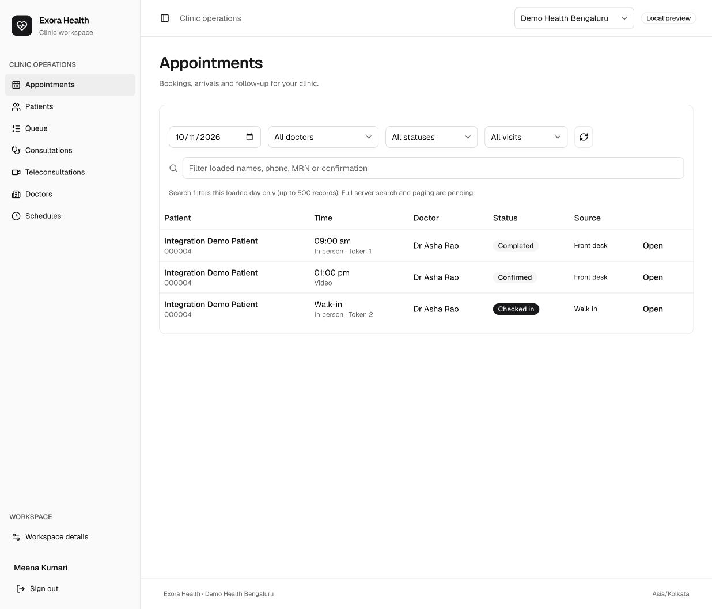
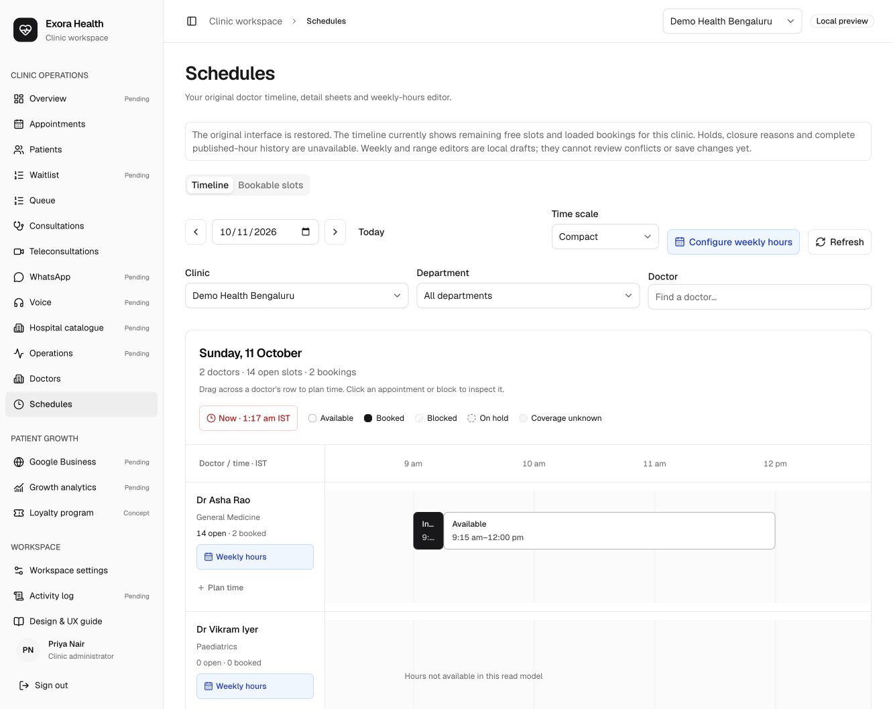
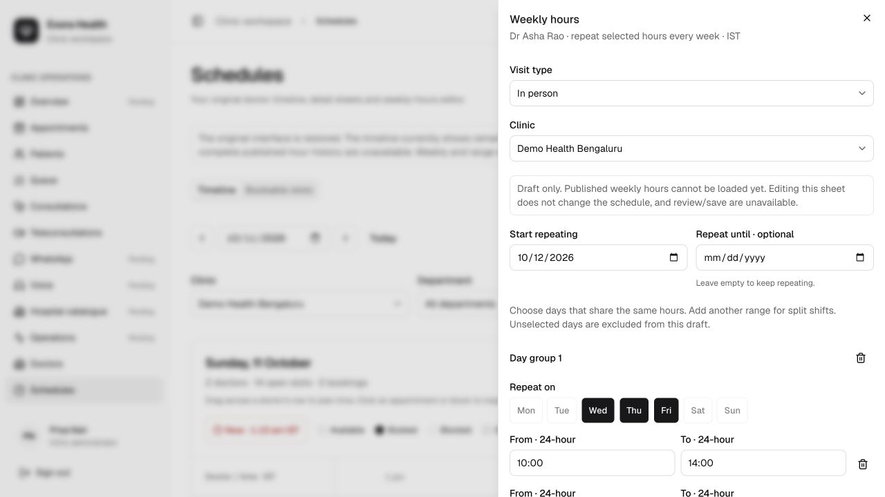

# Staff frontend integration checkpoint

11 October 2026, Asia/Kolkata. This records local implementation evidence separately from the original planning audit.

## Implemented

The selected dirty/untracked staff source was imported into `apps/staff-web`; all 73 original import hashes still match the external source. The monochrome Geist/shadcn components, sidebar, table and sheet styling are retained. Source provenance is in `apps/staff-web/SOURCE_PROVENANCE.json`. Original advanced modules remain dormant while their missing backend contracts are tracked.

Active screens connect sign-in/context, patients, appointments, queue, consultations, teleconsultations, practitioner directory and read-only remaining bookable slots to existing TypeScript APIs. Booking uses real holds, expiry/release and server slots; rescheduling follows the replacement appointment ID. Check-in requires patient identity. Walk-ins create today's arrival/token without inventing appointment times or a fee. Queue patient names use authorized demographic reads.

Clinical work uses care access, existing authorized care-team assignments, vitals, assigned-physician notes, version-aware editing/amendment/signing, diagnoses and disposition. Draft notes block visit completion. The UI does not expose the direct queue-complete shortcut or checked-in appointment cancellation that would bypass clinical lifecycle consistency. Nursing attestation remains deferred. Nursing self-join was reproduced failing and its control removed; G35 must be fixed before that workflow can be accepted.

Teleconsultation staff worklists, patient-link issuance/reissuance, assigned-doctor session actions and the isolated patient joining/consent page use existing telehealth contracts. The patient fragment token is removed from the address bar and held only in memory. The default video provider is shown as unconfigured for real calls. Staff verbal-consent/document publication UI waits for G34.

Transport uses memory-only bearer identity, tenant headers, scoped caches, caller cancellation/timeouts and no Python cookie/session API. Authorization failures clear cached records. Mutation keys stay stable for the same intent; unknown outcomes require recovery/readback. Polling pauses while hidden. Unsaved clinical/registration text and uncertain operations guard sidebar/facility/sheet navigation and page unload.

## Executed checks

| Check | Result | Evidence and limits |
| --- | --- | --- |
| Frontend transport/context tests | PASS, 13/13 | `node --import tsx --test apps/staff-web/tests/*.test.ts`; facility permissions, affiliations, nullable data, auth errors, context races, unknown outcomes, stable intent keys |
| Frontend TypeScript projects and production build | PASS | `tsc -b` and `vite build` in `apps/staff-web`; main JS approximately 551 kB uncompressed, bundle-size warning remains |
| Backend TypeScript check | PASS | Root `tsc --noEmit`; no backend domain source/migration changes |
| Frontend lint | PASS with warnings | `oxlint` exits 0, no errors and 19 warnings; retained-source and React effect warnings remain |
| Original selected source preservation | PASS | All 73 import-manifest hashes matched original source after integration |
| Synthetic core visit in browser | PASS | Register/search patient → hold/book → check-in → call-next → doctor records vitals, starts encounter, drafts/signs note and finishes consultation |
| Persisted core visit and worker | PASS | Confirmation KKLQR2T4: appointment completed, encounter finished, queue done, note signed, three observations |
| Synthetic walk-in in browser/database | PASS | Token 2 created; null slot times, checked-in appointment, waiting queue and arrived encounter |
| Teleconsultation worklist/link and patient page | PASS, local surface only | Scheduled virtual visit rendered; staff-issued link targets the current patient page; exact backend sample consent displayed and fragment removed |
| Nursing self-join | FAIL, backend defect recorded | Chart 403; self-join 409; no participant persisted. See [G35 receipt](staff-integration-audit/nursing-self-join-receipt.json); failing control removed |
| Production OIDC, deployment, real video and clinical/policy acceptance | UNVERIFIED | No production login/deployment/provider call or actual patient care was performed |

[Automated validation receipt](staff-integration-audit/integration-validation.json) records the executed checks and production development-login gate. [Database receipt](staff-integration-audit/integration-db-receipt.json) contains synthetic state only and no tokens. UTC timestamps may fall on 10 October; checks occurred on 11 October in the user's timezone. The upstream backend suite's previously documented 117 tests were not rerun for this frontend-only integration; do not interpret that baseline as a current run.

## Running preview and review

- Frontend: `http://127.0.0.1:5188/staff/appointments`.
- API: local port 3038, development authentication only.
- Worker and API share isolated database `hms_staff_integration`, PostgreSQL port 54339, data folder `.pgdata-staff-integration`.
- Branch: `codex/staff-frontend-integration` in the outer Paperwhale checkout. Changes are local; no PR, push or deployment.
- Start/configuration notes: [staff app README](../../apps/staff-web/README.md).

## Work remaining

All **40 backend areas** in [the ledger](BACKEND_WORK_LEDGER.md) remain open. Core integration does not imply full design parity. Advanced timeline/weekly/range edits, waitlist, staff operational notes, accounts/grants/config/audit and communications modules need the listed backend work. Directory/quote/observation definitions and server paging remain priority gaps.

Existing clinical correction, allergy/problem editing, entered-in-error, emergency access and note-template APIs still need their respective frontend flows. Navigation/page unload prompts have been checked by source inspection; browser Back/Forward and all conflict/offline/multi-facility races have not been exhaustively exercised. Role-specific clinical workflows, reschedule/cancel/no-show and real sign-in/video need further acceptance beyond the single core visit. This checkpoint is a completed first integration tranche, not acceptance of every master-plan gate.

## Subsequent original-UI restoration, 11 October

The user narrowed the scope to frontend implementation and backend documentation only. Backend work belongs to a dedicated agent. The initial-tranche results above remain historical evidence; this pass did not reset data, run migrations or change backend code.

The original timeline, weekly-hours/split-shift editor, range drafts, appointment details/notes and doctor profile layout now return to the active workspace. Free slots and timed visits are projected from existing scoped APIs; complete hours, holds/blocks and conflicts are still unavailable. Unsupported original saves/previews remain disabled. Additional module entries show their pending state; restoring navigation is not completion of their full forms.

[Original UI parity ledger](ORIGINAL_UI_PARITY_LEDGER.md) identifies 53 feature groups across 16 screens and their remaining frontend/backend work. All 35 backend ledger areas stay open. [Restoration validation](staff-integration-audit/ui-restoration-validation.json) records 18 passing frontend tests, build/typecheck, source/backend preservation and browser checks. The current main JS is 647.20 kB with a bundle warning; lint has 19 warnings and zero errors. The full backend suite was not rerun.

