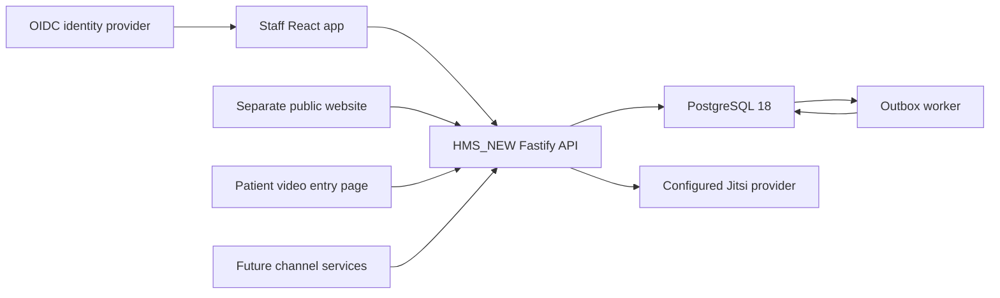

# Staff frontend → HMS_NEW integration master plan

Schema/workflow review: [frontend/backend contract decisions](FRONTEND_BACKEND_CONTRACT_DECISIONS.md). Preserve the original design while resolving incompatible semantics before enabling writes.

> Implementation update, 11 October 2026: the selected source is imported and core APIs are connected. See the [checkpoint](STAFF_FRONTEND_INTEGRATION_CHECKPOINT.md) for executed verification and the [35-area backend ledger](BACKEND_WORK_LEDGER.md) for deferred work. The audit below preserves its original baseline.

Date: 10 October 2026 (Asia/Kolkata). Status: **source-audited integration proposal; no application integration implemented**.

> Frontend-only restoration update: [original UI parity ledger](ORIGINAL_UI_PARITY_LEDGER.md). The user has assigned backend implementation to a dedicated agent. Missing APIs/fixes remain documentation-only in this frontend task. Original schedule/editor presentation is restored with explicitly partial data and blocked saves.

## 1. Decision and scope

Use the user-selected **`hms-monochrome/staff-web`** as the admin/staff interface. Preserve its monochrome appearance, appointment list, doctor-day timeline, shadcn/Base UI controls, and focused sheets. Adapt its domain operations to HMS_NEW and add the operational screens the new backend supports but this frontend lacks.

The target is a staff application for front desk, nurses, doctors, and tenant administrators. It is larger than a settings-only administrator console. Both this application and the separate public website ultimately use the same HMS_NEW backend, with different authorization and public/staff contracts.

**Do not reintroduce `Sachinskz/Hms-Frontend`, its mock adapters, screen inventory, or master plan.** That prototype was explicitly rejected. The public `hospital-webpage` is also not the source of the staff interface.

The recommended delivery sequence is:

1. A connected core: identity/facility selection → patient search/registration → standard-slot booking → arrivals/check-in → queue → consultation → visit completion.
2. Full parity for the selected scheduling UI: authoritative timeline, safe weekly/day changes, administrative notes, exact-time booking, and explicitly controlled overlaps.
3. Connected Virtual OPD, with its patient entry page and real provider acceptance.
4. Administrative setup and audit workflows; then separately migrate WhatsApp, voice, and growth operations if retained in the product scope.

Backend changes are required to achieve full parity. A URL prefix replacement cannot integrate this application. Do not relax reservation constraints, clinical access, or signed-note rules simply to preserve a button.

## 2. Exact source baseline and evidence

| Item | Inspected source |
| --- | --- |
| Staff source | `/Users/deepakonda/.codex/worktrees/hms-monochrome/staff-web` |
| Staff repository | `yeshwanth1127/hms-backend` |
| Staff branch / HEAD | `codex/appointment-workspace-monochrome` / `2b804d431f7a7bd7ad6f84b247aa8dd5e9b30633` |
| Staff working tree | Dirty: relevant tracked edits and untracked timeline, appointment actions, weekly hours, conversation, and concept files. **HEAD alone does not capture the selected UI.** |
| Target checkout | `/Users/deepakonda/Documents/antigravity/HMS_NEW` |
| Target backend | `/Users/deepakonda/Documents/antigravity/HMS_NEW/HMS_NEW` |
| Target repository / HEAD | `yeshwanth1127/exora-health`, `main` / `78912fdcee807e1cd2f0070c9a29105c22d785e3` |
| Backend runtime | Fastify + TypeScript + PostgreSQL 18, API plus outbox worker |
| Existing preview | `http://127.0.0.1:8035/staff/appointments`; the serving process's cwd was verified as `hms-monochrome` |

The audit independently inspected current React call sites, registered Fastify routes, command/query implementations, SQL migrations, permission seeds, event consumers, and existing tests. Documentation provides context; route and command source establishes present capability.

Supporting evidence in [staff-integration-audit/](staff-integration-audit/):

- [ui-api-calls.json](staff-integration-audit/ui-api-calls.json): **133 static API/resource/asset/link call sites**, including the public `book.tsx` and `talk.tsx` entry points and generic wrappers. These are not 133 unique endpoints.
- [backend-routes.json](staff-integration-audit/backend-routes.json): **67 registered method/path combinations**, including health/readiness, conditional development login, and five patient teleconsultation endpoints. The queue loop is expanded into its three concrete actions.
- [snapshot.json](staff-integration-audit/snapshot.json): source roots, commits, dirty source status, and SHA-256 hashes for the 65 scanned TypeScript files.
- [collect.cjs](staff-integration-audit/collect.cjs): rerunnable static inventory collector. Computed/wrapper expressions remain visible rather than being counted as resolved endpoints.
- [backend-gap-backlog.csv](staff-integration-audit/backend-gap-backlog.csv): prioritized implementation handoff.

No database reset, backend migration, provider interaction, outreach send, or application-source modification was performed during this plan. The rejected frontend was not used.

### Evidence boundaries

| Check | Result | What it establishes |
| --- | --- | --- |
| Staff TypeScript app + Vite config checks | PASS | Current source typechecks |
| Staff production build to a temporary directory | PASS | Current source bundles without replacing the running staff assets |
| Staff lint | PASS with warnings | No lint errors; warnings include effect state updates and Fast Refresh exports |
| Existing browser preview | Sign-in screen verified | It serves the staff application; no signed-in operational walkthrough was performed |
| New backend route/schema/consumer audit | PASS for inventory | Existing contracts and gaps identified from source |
| New backend test suite / integration browser tests | NOT RUN in this audit | The documented 117 tests are an upstream claim, not newly reproduced evidence |
| New API connection / persisted cross-app workflow | NOT IMPLEMENTED | This plan does not establish integration acceptance |
| Deployment / real video / real messages / real calls | UNVERIFIED | No provider or production acceptance claim |

## 3. Integration architecture

Recommended first implementation location: **`HMS_NEW/apps/staff-web` inside the exora-health checkout**. It stays a separately hosted staff SPA; co-location does not merge it with the public website. If the team requires a separate frontend repository, keep the same boundaries and publish versioned API contracts; do not change the product architecture to fit repository placement.

Before importing, preserve the entire selected dirty staff snapshot, including untracked source. Record its source hashes. Copy frontend source/configuration, not its old `.env`, node_modules, generated assets, Python application, databases, uploaded patient media, or credentials. Preserve relevant source provenance and Arc licensing metadata. Do not remove the old worktree until the new connected preview has passed its acceptance checks.

Use a dedicated API transport and small domain modules: `auth`, `directory`, `patients`, `appointments`, `calendar`, `queue`, `clinical`, `telehealth`, and `admin`. Components call domain functions, not literal endpoint strings. Keep display models explicit where old React components expect a different shape. Do not build a permanent emulation layer for every old Python endpoint.

Use the existing lightweight resource approach initially, extended for cancellation of stale requests, tenant/facility cache keys, loading/error preservation, and invalidation. A new global state framework is not a prerequisite. Lazy-loaded feature modules and the current design system can remain.

Do not serve the old `book.html` and `talk.html` in the staff deployment. They are public booking/voice entry points with separate session contracts. Their inventories are included to prevent accidental loss during extraction, not to authorize their migration as staff features.

### Hosting and development

- Preserve `/staff/` as the SPA base initially; configure a SPA fallback for nested routes. Update Vite's build output to the new application's own `dist`, not `../app/staff_static`.
- Use the inner monorepo's pnpm workspace and Node runtime policy. Resolve the staff Vite/React toolchain's engine requirements before importing the dependency graph; do not assume the old build's Node 26 result qualifies Node 22.
- Development proxy routes must target the exact new API process. Its default port 3000 is already used by another local process; choose an explicit free development port and verify its service identity. Do not infer the target from the port alone.
- Add the actual staff preview origin to `CORS_ORIGINS`, or use same-origin reverse proxying. The old proxy's `/api → :8012` is not the new integration.
- Production can reverse-proxy `/v1`, `/tele/v1`, `/health`, and `/ready` to Fastify while serving `/staff/` statically. Development login must remain unavailable in production. Provider secrets stay server-side.
- Run the worker alongside the API. A healthy API alone does not establish that check-in creates an encounter or that encounter completion reaches the booking/queue.

## 4. Authentication, permissions, and tenancy

| Existing UI assumption | HMS_NEW contract | Required change |
| --- | --- | --- |
| Username/password POST `/api/v1/staff/login` | External OIDC tokens; dev-only POST `/dev/login` | Replace the production password form with OIDC sign-in; provide a visibly local-only demo identity picker |
| HttpOnly staff cookie + `X-CSRF-Token` | `Authorization: Bearer`, optional `X-Tenant-Id` | New transport and auth lifecycle; do not keep the CSRF token as a bearer token |
| Session contains `user.role` and `environment` | GET `/v1/me` returns staff type and facility-scoped permissions, not one role or environment | Compute actions from permissions; obtain environment/capability metadata separately |
| Global `allowed: Record<string, boolean>` | Permission → list of facility IDs, or `*` | Every action checks the selected facility; changing facility invalidates visible data and actions |
| `admin`, `staff`, `growth_manager` roles | Tenant admin, front desk, doctor, nurse, auditor, integration accounts | Replace role-name routing with capability routing; `staffType=admin` does not imply tenant-administrator authority |
| Built-in user/password management | IdP identity plus `platform.user_account` and role grants | Replace password-reset/change with the selected IdP flow; implement account linkage/role-grant administration separately |

Keep access tokens in memory initially and use the chosen OIDC library's authorization-code + PKCE flow. Do not persist patient join tokens or provider JWTs in logs, analytics, or localStorage. This is a recommended SPA deployment choice; if the product later chooses a BFF, define its session/CSRF contract explicitly rather than supporting both implicitly.

Multi-tenant login needs a concrete discovery flow. Today `resolvePrincipal` returns tenant IDs in a validation error when an identity has several active accounts, but no friendly tenant metadata endpoint exists. The core can handle those IDs and call `/v1/me` with the selected `X-Tenant-Id`; a production selector should get authorized tenant names through G02.

Use GET `/v1/me` as the authority for actions. Refresh after identity/facility changes and permission errors. A 401 can end the staff session; a 403 must preserve the session and show the missing access. Generic network errors must not silently turn into “not logged in.”

**Facility scoping requires backend review as well as UI filtering.** `authorize` permits any scoped grant when no facility is passed. The current sessions endpoint calls it without a facility and returns sessions across a practitioner's facilities. `endWeeklySession` also authorizes without loading the affected rule's facility. Empty day-plan replacement can affect multiple facilities. Tenant RLS does not by itself constrain these operations to role-granted facilities. G01 defines the required negative tests and server fixes before multi-facility acceptance. This is a source-level concern, not a reproduced exploit.

Patient demographics are currently tenant-wide reads under `patients.read`; do not silently redefine them as facility-only. The team should explicitly retain or change that policy. Clinical charts still require both clinical permissions and a care relationship; an admin role is not evidence of clinical authorization or assigned-doctor teleconsultation access.

## 5. Screen-by-screen contract map

Status vocabulary: **ADAPT** = underlying operation exists, UI contract differs; **PARTIAL** = some backend work needed; **NEW UI** = backend exists but connected screen is missing; **NEW MODULE** = substantial backend service work; **PREVIEW** = synthetic concept only.

| Existing/needed surface | Existing React source | Target capability | Status and action |
| --- | --- | --- | --- |
| Workspace sign-in and shell | `App.tsx`, `lib/api.ts`, `components/workspace.tsx` | `/dev/login`, `/v1/me`, OIDC | ADAPT; add tenant/facility context and capability navigation |
| Appointments worklist | `modules/NurseDesk.tsx` | GET `/v1/appointments`, detail and action endpoints | PARTIAL; retain list design, add server search/paging and identity linking |
| Standard booking | `schedule-range-actions.tsx` currently uses exact ranges | slots → holds → appointments | ADAPT; explicit slot flow, hold expiry, correct patient/booker identity |
| Move appointment | `appointment-actions.tsx`, `BookingOperations.tsx` | hold → POST appointment `/reschedule` | ADAPT for slots; exact-range moves need G08 |
| Remove appointment | `appointment-actions.tsx` | POST appointment `/cancel` | Change label to Cancel first; optional archive/entered-in-error semantics need G10 |
| Appointment staff notes | `appointment-notes.tsx` | No administrative-notes API | PARTIAL; G09, never repurpose clinical notes or the patient's visit reason |
| Doctor list/edit | `clinic.tsx` | GET `/v1/practitioners`; no equivalent profile/fee PATCH | PARTIAL; read adapter plus G14 for editing |
| Doctor-day timeline | `schedule-timeline.tsx` | sessions, slots, appointments | PARTIAL; G04 for complete periods, holds, historical coverage and scoped aggregation |
| Open one-day hours | `schedule-range-actions.tsx` | exceptions `extra_hours`, day plans | PARTIAL; virtual-mode and safe merge gaps, G06/G07 |
| Block/unblock and review conflicts | `schedule-range-actions.tsx`, `BookingOperations.tsx` | exceptions creation only | PARTIAL; G05/G06 for preview, commit conflict policy, listing and reversal |
| Weekly hours sheet | `weekly-hours.tsx` mounted by timeline | add/end individual weekly sessions | PARTIAL; G07 for read and atomic replacement; retain sheet, no new full-page rule editor |
| Waitlist | `BookingOperations.tsx` | Waitlist tables exist; no routes/commands exposed | PARTIAL; G11, not “schema absent” |
| Overview/operations dashboard | `operations.tsx` | Worklists + health/readiness; no equivalent metrics/event dashboard | PARTIAL; scoped aggregation G12; technical operations diagnostics should be admin-only |
| Hospital catalogue | `operations.tsx` | Directory reads; schema for facilities/departments/services/prices | PARTIAL; G13/G14 for read/setup APIs; can start read-only |
| Patient search/registration | No dedicated module | `/v1/patients` POST/GET/detail | NEW UI, build now |
| Arrival identity resolution | Old detail assumes patient name/phone on appointment | `patientId` may be absent; check-in requires patient linkage | NEW UI inside arrival sheet, build now |
| Queue board | No dedicated connected module | `/v1/queue`, call-next, token actions | NEW UI, build now; G15 completion policy |
| Doctor encounter worklist/workspace | No dedicated module | `/v1/encounters`, lifecycle, vitals, notes, diagnoses | NEW UI, build now |
| Nursing assessment | “NurseDesk” is an arrival list, not clinical assessment | Encounter vitals/nursing notes | NEW UI inside encounter workspace; vitals first, G27 before nursing notes |
| Longitudinal patient chart | No dedicated module | Chart, allergies, conditions, encounters, break-glass | NEW UI; access-denied and emergency-access flows required |
| Teleconsultation staff queue | `feature-concepts.tsx` | `/v1/teleconsults` and lifecycle/link grants | PREVIEW → connected NEW UI; keep useful queue layout, replace fictional state |
| Patient video entry | Patient view inside concept | `/tele/v1/session` and consent/check-in/join/leave | NEW UI outside staff authentication; provider setup still required |
| Users/permissions/settings | `settings.tsx` | Tables/permissions exist; no user/grant/config admin API | PARTIAL; G16/G17, IdP-owned passwords |
| Activity log/export | `settings.tsx` | Audit writes exist; no list/export API | PARTIAL; G18 |
| Demo reset/clear | `DemoControls.tsx` | `db:reset` is a local CLI, not a staff API | Replace with offline dev tooling; no production reset route |
| WhatsApp inbox/replies/assets/follow-ups/campaigns | `conversations.tsx`, `whatsapp.tsx`, `campaigns.tsx` | No channel module in current new API | NEW MODULE; G19/G20; preserve source for later migration |
| Voice history/transcripts/recordings | `voice.tsx` | No voice session/history contract | NEW MODULE; G21; current mocks are not provider proof |
| Google Business/growth | `growth/*` | No equivalent new API | NEW MODULE; G22; distinguish editing local links from updating Google |
| Clinic loyalty/membership | `feature-concepts.tsx` | No membership capability | PREVIEW; G23 only if product retains it |
| General patient demographics/flags/consents editing | No dedicated connected module | Permission/table support exceeds exposed patient routes | PARTIAL; G24; teleconsult consent API is not a general patient-consent API |

The connected first release should hide unsupported module navigation. Retain its source with explicit capability metadata; do not render broken menus or fabricate empty data as evidence that a module is active.

## 6. Workflow/design divergences and decisions

### 6.1 Booking grid, arbitrary minutes, and controlled overlap

Current timeline permits selecting exact minute ranges and has stacked lanes for overlapping visits. HMS_NEW's hold request accepts `staffId` and `slotStart`; it derives the end from published slots. The reservation exclusion constraint prohibits overlapping held/booked reservations for the same resource across facilities.

First connected flow: snap selection to actual server-returned slots, show the derived duration, and use hold → confirm. Do not send an ignored `endsAt` field. Label available hours separately from an immediately bookable slot. Walk-ins use `/v1/walk-ins` and token capacity, not a fabricated calendar booking.

Full timeline parity: G08 adds a separate exact-range staff command with server validation for contiguous published time, live holds, blocks, visit mode, active affiliations, cross-facility occupancy, and retries. Controlled overlap also needs a deliberate reservation allocation design/migration. Recommended design exploration: explicitly allocated parallel booking lanes with overlap excluded per lane and a server-locked capacity policy; reject cross-facility simultaneous attendance and ordinary-channel overlap. Prove the model under PostgreSQL concurrency before selecting it. **Never just drop `reservation_no_double_booking`.**

The old Python `booking_policy` can enable overlap globally even when an individual form did not explicitly request it; the booking route can supply a generic overbooking reason. The new UI should make overlap an explicit action: current conflicts, requested capacity, and a staff-entered reason. A policy switch alone must not silently authorize every normal booking. Keep the selected interface's two/three lanes as presentation, not proof that the new backend allows them.

### 6.2 Rescheduling identity changes

HMS_NEW rescheduling creates a new appointment linked by `rescheduledFromId` and cancels the original. The selected UI describes moving the current appointment's time and expects a full updated old-style row.

After a move, follow the returned new appointment ID, refetch both records/boards, show old→new history, and rotate/check teleconsultation links as required. Do not keep writing staff notes to the cancelled predecessor. Full arbitrary-range moves must preserve this history or deliberately define a new audited move contract; do not implement a hidden in-place mutation in the frontend.

### 6.3 Cancelling versus deleting

The old Delete button performs cancellation plus soft deletion and offers a Deleted filter. HMS_NEW has cancellation and retained history, but no deletion marker or delete API.

Use Cancel with a reason in the first connected release. Preserve cancelled appointments in filters/history. If hiding mistakes is required, G10 defines a distinct administrative archive/entered-in-error state with retention and permissions. Do not hard-delete appointments, reservations, encounters, or audit records. A cosmetic “Deleted” badge must not be synthesized from every cancellation.

### 6.4 Visit completion has two current backend paths

The current UI offers direct appointment completion. The new clinical route requires an in-progress encounter, disposition, and no draft notes before `/finish`, after which the worker completes the appointment/queue. However, `queue.ts` currently also allows `/queue-tokens/:id/complete` to mark an appointment completed directly without finishing its encounter. Front desk and nurses receive `queue.manage` in the seeds.

Starting service and starting an encounter also run independently: there is no registered encounter-start consumer synchronizing the token. Cancellation accepts a checked-in appointment even if its encounter has started, while the worker only cancels encounters that have not started and only waiting/called queue tokens are cancelled. G15 must define these transitions together, reject ordinary reception cancellation during active care, and make any clinical abort a separate audited action. Concurrent cancel/start/finish must not leave contradictory terminal states.

This is a concrete source-level consistency issue. G15 makes encounter completion authoritative for clinical visits and guards or delegates token completion when an active encounter exists. Remove reception's “complete consultation” shortcut; front desk can manage arrival/queue, while clinical completion belongs in the encounter flow. Decide explicitly whether nurses can finish encounters: their seeded `encounters.manage` currently permits it. UI hiding alone does not settle backend clinical role policy.

### 6.5 Patient identity versus booking party

HMS_NEW allows a booking by a relative/caller before a registered patient exists. `bookingPartyName`/phone must not be relabelled as verified patient demographics. The UI must show “Patient not linked” and resolve/register a patient before check-in. Registration asks for given/family name, sex, optional birth date/phone, and the registered facility; consent and contacts are separate entities.

An appointment for a registered patient can have no booking party phone in the current read model. Fetch demographics through patient detail, or add a narrowly authorized primary-contact projection to the appointment list. Do not display a blank contact as a backend failure or fabricate a phone from another record. Walk-ins have null `startsAt`/`endsAt`; render token/session information instead of passing null into the old time helpers.

### 6.6 Schedule editing and conflicts

The existing UI requires resolving affected appointments before a block/weekly change. New `addScheduleException` and `addFacilityHoliday` save first and return affected IDs afterward. Day plans use latest revision wins with no client base revision; ending weekly rules and adding replacements are separate requests.

G05/G07 preserve the selected preview→resolve→commit workflow: preview is advisory; commit repeats conflict checks under the same relevant calendar lock/transaction, enforces a revision/hash, and rejects stale or unresolved conflicts. Sequential end/add calls from React are not an atomic replacement. Ensure holds are revalidated when hours change; a preview response is not permission to save against a newer state.

The selected block UI is scoped to a clinic. The new exception constraint requires `facility_id=NULL` for closed/block exceptions, so they apply to the practitioner across facilities; only extra-hours exceptions carry a facility. The integration must offer an explicit all-facility closure, or add an auditable facility-scoped exception model with corresponding authorization and availability changes. Never silently turn a selected-clinic block into practitioner-wide leave.

Published weekly hours differ too: the new `schedule_rule_no_overlap` exclusion constraint prohibits overlapping practitioner rules across facilities/modes. The old UI can preserve overlapping alternative offerings and rely on actual reservation locks. Use non-overlapping published hours for the first release. If simultaneous virtual/in-person or alternative-clinic offerings are required, design that schedule model separately while keeping actual attendance/reservation constraints intact. G07 must report the mismatch instead of losing other schedules.

The new `extra_hours` SQL emits `in_person` and has no visit-mode parameter. The UI offers virtual hours. G06 must add compatible visit-mode handling or use a complete virtual day-plan operation; never map a virtual selection to an in-person session.

Current weekly UI uses Monday=0 and inclusive `effective_until`; the new API uses ISO Monday=1 and exclusive `effectiveTo`. Map weekdays explicitly, and convert an inclusive end date to the following facility-local date. Preserve split shifts, other-facility schedules, walk-in-only sessions, healthcare service, room, and visit mode when replacing hours. The current sessions projection omits several of those fields, so it is insufficient for a lossless editor.

The old code treats a virtual clinic as a special branch. HMS_NEW treats `visitMode=virtual` as a session/appointment property at a real facility. Change clinic selection accordingly; do not create a fake facility solely to satisfy `is_virtual` filtering.

### 6.7 Timeline truth and historical visibility

The selected board distinguishes available, booked, blocked, and held periods, expiry, staff notes, exception reason, and counts. New slots only distinguish free/taken/blocked and omit slots that start before the current clock. Sessions omit closures/holidays and do not carry raw exception IDs; there is no held-period list API.

Combining sessions + slots + appointments can support an interim future-slot view, but cannot reproduce the complete historical board, hold expiry, or full-day closure explanation. Do not call that full parity. G04 adds a scoped authoritative board/read model using the same scheduling authority as commands; no browser-only subtraction engine should define availability.

### 6.8 Prices and notices

The existing UI displays a doctor's rupee consultation fee. New booking snapshots use integer `feeMinor` from active service/price-list rules. Practitioner reads do not expose an editable price. Add a price/quote read for pre-confirmation; show an unknown quote as “Fee not available,” not ₹0. A quote is advisory and booking remains authoritative. Pricing edits belong to the catalogue/price-list workflow, not a direct doctor fee field.

The old NurseDesk can say “The patient will get a WhatsApp message” after staff changes. HMS_NEW emits events but has no notification consumer. Initial UI must report “Appointment updated; contact the patient” without claiming a queued or delivered message. G19 introduces real notification states and deduplication; queued, accepted, delivered, failed, and manual contact required remain distinct.

### 6.9 Operational notes, clinical notes, and readiness

Appointment staff notes are administrative coordination. Clinical notes are versioned, authored, signed, and amended under chart-access rules. Do not reuse `/v1/encounters/:id/notes` for reception notes. G09 adds an audited/versioned booking annotation contract.

**Nursing note lifecycle is currently incomplete.** Nurses have `clinical.write` but no `clinical.sign`; signing is author-only, so a doctor cannot sign a nurse-authored draft. Any draft blocks encounter finish. Enabling nursing notes without G27 therefore creates a visit that cannot finish normally. Define note-type-specific nursing attestation/registration rules, or an explicit co-sign workflow retaining the original author. Do not grant unrestricted doctor-note signing or void valid nursing documentation as a workaround. Until resolved, U07 can support vitals only with its limitation explicit.

Keep the monochrome visual system and add textual labels to states, keyboard alternatives to drag selection, and visible conflicts. Device/video readiness comes from actual permission/device/provider outcomes; design-preview readiness labels must disappear when the feature is connected. A join grant or opened link does not prove attendance or completed care.

## 7. Backend gap register and proposed contracts

Every endpoint below is **proposed**, unless explicitly marked existing. Names are implementation suggestions, not current route guarantees. Priorities: **P0** blocks a truthful/consistent connected core; **P1** needed for selected interface parity or operational administration; **P2** separate module expansion. A screen can launch with a scoped read-only reduction only where the reduction is visibly stated.

| ID | Priority | Gap / proposed contract | Backend change and frontend response |
| --- | --- | --- | --- |
| G01 | P0 | Facility authorization of scheduling reads/writes | Resolve actual rule/plan/exception scope on every command; filter board/session reads; test a branch-A-only principal against branch B, mixed-facility day plans, global blocks and guessed IDs |
| G02 | P0/P1 | Session context metadata; proposed GET `/v1/session-context`, GET `/v1/me/tenants` | `/v1/me` exists; add authorized tenant names, supported modules/environment and permitted facility metadata; retain backend checks, avoid treating flags as permissions; tenant discovery is P1 if pilot is single-tenant |
| G03 | P0 | Extend GET `/v1/appointments` with search, paging, visit-mode and channel filters | Server query across patient/booker name, contact, confirmation/MRN and practitioner; deterministic cursor/order, `nextCursor`/`hasMore`; configurable bounded ranges and counts. Current cap of 500 is not paging |
| G04 | P1 | Proposed GET `/v1/calendar-board?facilityId&date&staffId` | Complete scoped sessions/appointments/active holds/blocks/closures, source IDs, reason, asOf, revision, server slot counts; no unauthorized other-facility patient details |
| G05 | P1 | Proposed POST calendar change `/preview`; conflict-checked commit | Define typed preview for block, closure, holiday and schedule replacement; save repeats checks/locking, returns 409 + fresh conflicts; no persisted change on rejection |
| G06 | P1 | Calendar reads/reversals; proposed GET `/v1/practitioners/:id/exceptions`, POST `/v1/calendar-exceptions/:id/revoke`, holiday read/revoke | Existing exception/holiday creation only; expose identity/reason/visit mode and auditable reversal; virtual extra hours must not be coerced to in-person; distinguish clinic-specific blocks from current practitioner-wide exceptions; select full-day vs timed scopes explicitly |
| G07 | P1 | Proposed GET/PUT `/v1/practitioners/:id/weekly-plan`, GET day plan; harden existing PUT day plan | Atomic versioned replacement with effective dates, preserved service/room/mode/walk-in capacity and conflict review; affiliated active practitioner validation; cross-facility collision checks and explicit policy for overlapping published offerings; retries must not append duplicate revisions |
| G08 | P1 | Proposed POST `/v1/staff-bookings/check`, POST `/v1/staff-bookings`, POST appointment `/move-range` | Exact-time staff booking/move; explicit optional overbook with permission + tenant policy + reason; concurrency-safe parallel allocation design required; standard `/holds` stays strict |
| G09 | P1 | Proposed GET/PATCH `/v1/appointments/:id/staff-notes` | Administrative annotation with `baseVersion`, reason/provenance/history; add schema if needed; appointment reason and clinical note are not substitutes |
| G10 | P1 conditional | Optional appointment archive/entered-in-error command and filter | Cancellation exists. Implement only if separate removal semantics are retained; history/retention and clinical impact must be defined; otherwise rename old Delete to Cancel |
| G11 | P1 | Proposed `/v1/waitlist`, entry offers/withdrawal and accept/decline | Tables exist, command/API/worker lifecycle absent; hold expiry, de-duplicated offers, conflict-safe acceptance, permissions and patient delivery are still needed |
| G12 | P1 | Proposed GET `/v1/operations/summary?facilityId&date` | Shared server definitions for booked/arrived/waiting/in-consultation/completed/cancelled/no-show, asOf and freshness; no clinical chart contents in dashboard; admin diagnostics separate |
| G13 | P0 read/P1 write | Proposed directory endpoints for departments, services, rooms and booking quote | Current facility/practitioner reads insufficient for editors/fee display; quote respects service/mode/date/practitioner, expose `feeMinor`/currency/unavailable; public catalogue API is separate; add observation-definition/terminology reads before configurable vitals or coded diagnosis pickers |
| G14 | P1 | Proposed practitioner profile, affiliation, registration and price-list administration | Existing reads + tables/permissions, no profile PATCH/admin pricing HTTP; use versions, active affiliations and separate `pricing.manage`; doctor hiding/profile edits must not cancel existing visits implicitly |
| G15 | P0 | Queue/encounter completion and clinical role alignment | Guard current token-complete route against leaving an open encounter; synchronize queue/encounter starts and cancellation; define authority for nurse/admin encounter completion; worker and cancel/start/finish race tests; finish clinical visit only through the agreed clinical command |
| G16 | P1 | Proposed staff accounts, roles/grants and care-assignment administration | Link IdP subject to active staff; grant scope/time/version, revoke/disable; published permission catalogue; protect system roles and prevent unauthorized grants. No new bespoke password store |
| G17 | P1 | Proposed GET/PUT module/config settings | `platform.module_state`/`config_setting` exist, no admin API; implement lifecycle and version checks in server command runner, not just navigation toggles; channel settings only when their services exist |
| G18 | P1 | Proposed GET `/v1/audit-events`, bounded export, break-glass review | Audit/exception grants exist in DB, read/review APIs absent; scoped paged records, privacy-filtered export, audited review by another authorized person |
| G19 | P1 manual/P2 provider | Patient-change notification/readback contract and communications worker | Emit durable manual-contact task/state immediately if automated channels absent; later provider template/consent policy, de-duplication, receipts/retries and delivery webhooks; do not infer delivery from outbox rows |
| G20 | P2 | WhatsApp administration/inbox/assets/campaign module | Preserve old UI as deferred source; design comms/integration/documents contracts, case state, media retention, opt-out, approval/send authority and service-account booking; no browser Meta credentials |
| G21 | P2 | Voice session/config/transcript/recording/access module | Backend runtime/provider mapping + retention/access audit; original/translated turns, booking reference, safe playback; service-account booking integration; verify completed real calls separately |
| G22 | P2 | Google/growth read and admin module | Branch booking links, change history, website events/conversion definitions and upstream action capability; explicit demo/production separation; avoid local link edits labelled Google synchronization |
| G23 | P2 conditional | Membership/benefits module | Synthetic concept only; define product terms, identity/eligibility/benefit ledger and auditing before connecting; no guessed pricing or balance semantics |
| G24 | P1 | Patient demographics/contact updates, flags and general consent | Current patient module only register/search/detail despite seeded write permissions; versioned PATCH, flag commands/history and consent capture/read; no duplicate general-consent inference from tele consent |
| G25 | P1 | Machine-readable/shared request/response contracts | `packages/contracts` currently contains only README, not exported schemas/types. Publish schema/types or generated OpenAPI from actual routes; never import DB runtime modules into browser code |
| G26 | P0/P1 | Retry/reconciliation for mutations and calendar edits | Keep existing required header idempotency for create/check-in/move actions; add replay-safe calendar writes and version checks; lookup/refetch after unknown outcomes; don't blindly mint a new key after timeout |
| G27 | P0 when nursing notes enabled | Note-type-scoped nursing attestation or explicit co-sign contract | Nurses can create drafts but cannot sign; doctor cannot sign another author's draft; all drafts block finish. Define nursing qualification/permission policy, preserve authorship/version history, and prove nurse-note → doctor finish without voiding valid notes. Vitals-only U07 can precede this correction |

### Essential first backend slice

Before the connected core is qualified: G01 scheduling scope, G03 worklist querying, the minimum G13 read/quote contract, G15 completion policy, G26 transport/retry handling, and G27 before enabling nursing notes. G02 can initially be a local build capability manifest plus `/v1/me`, provided production environment/module state is not fabricated and the pilot is single-tenant. Directory setup can remain seeded/read-only for the first pilot, with that operational limitation explicit.

The full selected timeline cannot be called integrated until G04–G09 are implemented or the corresponding unavailable actions are clearly removed from the connected navigation. Exact-time/overlap and weekly replacement deserve independent backend review because they affect reservation authority, not just presentation.

### Example shapes to settle during implementation

These examples specify required concepts without claiming an existing API schema.

**Appointment list:** `{items, nextCursor, asOf}`; filters include facility, bounded dates, practitioner, status, visitMode, originChannel and search. Items distinguish patient identity, booking party, nullable contact/time, token and clinical progress. Use the canonical appointment ID and stable sorting with an ID tie-breaker.

**Calendar board:** `{facilityId, date, timezone, asOf, revision, rows}`. Each row has practitioner identity and periods with type, start/end, source record ID, visit mode, reason/hold expiry when authorized, and appointment reference only when `appointments.read` covers that facility. Cross-facility busy windows can be redacted rather than reveal another branch's patient.

**Calendar preview/commit:** request includes change type, affected practitioner/facility/date scope and base revision. Preview reports impacted bookings and holds plus a preview hash. Commit rechecks those inputs under a shared scheduling lock, validates the revision/hash, and returns changed IDs or fresh conflicts. It must not trust a list supplied by React as proof that all conflicts are resolved.

**Staff note:** `{text, baseVersion}` → `{text, version, updatedAt, updatedBy}` with history; text is coordination only. Existing 2,000-character limit is a useful initial bound. Keep patient-facing notices separate.

**Notification readback:** `{changeId, state, reason, taskId}` where state can be manual_contact_required, queued, accepted, delivered or failed. Staff can see the real follow-up requirement without a promise of automatic delivery.

## 8. New UI needed for the supported backend

| ID | Screen/flow | Minimum content and actions | API dependencies |
| --- | --- | --- | --- |
| U01 | Tenant/facility context | Identity, authorized facility selector, scope label, permission-aware home, context switch clearing old data | `/v1/me`, facilities; G02 for production metadata |
| U02 | Patient search + register | MRN/name/phone/ABHA lookup, existing record confirmation, create with source/facility, ambiguous matches without automatic merge | Existing patient endpoints |
| U03 | Booking/arrival sheet | Patient vs booker, slots, hold countdown, quote, booking kind/mode, check-in identity resolution, token result | Existing holds/appointments/patients + G13 |
| U04 | Queue board | Practitioner/facility/day, actual priorities/tokens, call-next/skip, clinician handoff, empty/stale/permission states | Existing queue API + G15 |
| U05 | Encounter worklist | Arrived/in-progress/finished states, assigned doctor, patient/encounter IDs; waiting for worker after check-in | Existing encounter worklist and appointment lookup |
| U06 | Doctor consultation workspace | Start, chief complaint, chart/vitals, template note edit, diagnosis, sign/amend/void, finish/disposition/follow-up and unsigned-note blockers | Existing clinical APIs |
| U07 | Nursing assessment | Vitals with units/effective time, nursing note, correction/error entry; no implied doctor signature authority | Existing observation APIs; G27 before enabling nursing notes; G13 for configurable definitions |
| U08 | Patient chart | Problems/allergies/history, correct status, authorized encounter links, chart access denied, reasoned expiring break-glass | Existing clinical APIs; G18 for review |
| U09 | Virtual OPD staff queue/detail | Actual waiting/consent/link state, issue/rotate patient link, doctor-only start/join/identity/end, separate clinical finish | Existing teleconsult API |
| U10 | Patient video entry | Fragment token capture, consent version, join window, device check, waiting/polling, join/leave/reconnect/closed/error | Existing `/tele/v1` + Jitsi configuration |
| U11 | Admin setup | Staff identity linkage, role/facility grants, practitioner registration/affiliations, service/price/readiness setup | G13/G14/G16/G17 |
| U12 | Audit / exception review | Paged activity, safe export, unresolved manual-contact items, emergency-access review | G18/G19 |

Keep the same typography, spacing, sidebar and component primitives for these screens. Add “Patients”, “Queue”, and “Consultations” navigation according to permissions; add clinician worklists rather than extending an arrivals table into a full chart editor. Do not rename the existing `NurseDesk` and assume a nursing workflow has been delivered.

Clinical notes need author/version/status visible, explicit save/sign actions, stale-edit conflict handling, unsaved-change protection, and signed amendment reasons. Use published note-template fields; template validation exists but is limited, so do not claim a full clinical form engine. A zero-draft encounter can currently finish; do not invent a mandatory clinical documentation rule without product/clinical agreement.

### Additional UI outside the current backend scope

| Future flow | Current backend boundary | Integration implication |
| --- | --- | --- |
| Prescriptions and medication reconciliation | Pharmacy/prescription APIs are not implemented | A doctor note is not a structured prescription or medication list. Add the domain/API before offering prescribing as a connected feature |
| Lab/imaging ordering and results | Orders/results APIs are not implemented | Diagnosis entry does not deliver order, collection, result review or acknowledgement; add these worklists with the backend module |
| Billing, invoices and payment collection | Booking fee snapshot exists; billing/payment APIs do not | Show quoted/booked fee only. Do not label it an invoice, payment receipt or balance due |
| Document upload/view | No document upload contract | Defer attachments or build storage/access/retention APIs before exposing an upload control |
| Admission/ward/bed operations | Not implemented in the current operational API | A disposition of admitted does not create an admission or allocate a bed; require the inpatient module and separate staff flows |

These are scope decisions for a complete HMS, not blockers for a clearly limited OPD pilot. A clinic that depends on prescribing, payments or orders needs the corresponding backend and UI before those workflows can be represented as connected.

Doctor teleconsultation access is assigned-doctor restricted beyond general permissions. The admin “Start call” affordance in a concept cannot bypass that rule. Patient token links are shown once; provide explicit copy/open/reissue actions, prevent link capture in analytics, and visibly warn that reissue invalidates the previous link.

## 9. Transport, state, and contract implementation rules

1. Use a transport returning structured errors: HTTP status, `error.code`, `error.details`, `requestId`. Preserve validation field errors, `no_care_relationship`, `unsigned_notes`, expired hold, and conflict reasons.
2. Send `X-Request-Id` for traceability; create a stable `Idempotency-Key` per user intent on required mutations and retain it across retries. Existing body `idempotency_key` must become the header, not simply camelCase JSON.
3. Distinguish not-sent, sending, known failure, committed, and outcome unknown. On timeout, retry with the same key or reconcile canonical records; do not show success before commitment.
4. After create/move/cancel/check-in, refetch authoritative detail/list/board. Queue and encounter progress can be asynchronous. Show “Creating encounter” with bounded retries and a recoverable delayed state, not an endless spinner or a second check-in.
5. Scope caches by identity, tenant, facility, and query. Clear data on logout/tenant switch; do not briefly display the prior facility's patient rows while refreshing.
6. Server search/paging applies to all eligible records. Client filtering of the first 200/500 cannot implement “All appointments” or reliable total counts. Keep the current search/filter interaction with a different data adapter.
7. Start with visible-screen polling; cancel on unmount, slow/back off on errors, and avoid firing a three-second worklist poll once per hidden module. No new websocket infrastructure is needed for the first pilot.
8. Dates/times use the facility timezone. The selected source contains fixed `+05:30` conversions; retain them only if supported facilities are explicitly IST. Display nullable walk-in times correctly. Keep UTC instants separate from local calendar dates.
9. Money remains integer minor units. `feeMinor=null` is unknown, not free; old rupee `consultation_fee` is not the canonical pricing field.
10. Contract DTOs are explicit. Practitioner identity is `staffId`, not an old `doctor.id`; facility replaces branch; appointment ID is `appointmentId`. Avoid a global snake_case conversion that erases semantic differences.
11. Do not expose database-generated types wholesale to the browser. Publish safe DTOs/contracts excluding internal notes, access tokens, audit secrets and other-facility records.
12. Preserve error/stale states in the selected shadcn UI. Keep old `useResource` behavior from erasing a usable board on an unrelated secondary endpoint failure; load independent capabilities independently.

## 10. Delivery phases and dependencies

| Phase | Deliverables | Exit gate |
| --- | --- | --- |
| P0 — Preserve/extract | Snapshot selected dirty source; import only staff source into `apps/staff-web`; change build/proxy; add capability manifest and domain API modules | Source parity hashes/provenance recorded; builds on agreed Node runtime; old worktree unchanged; no old mock frontend |
| P1 — Context and core backend corrections | OIDC/dev login, tenant/facility context; G01/G03/G13 minimum/G15/G26; G27 design before nursing-note UI; agreed completion role policy | Restricted users cannot cross facility boundaries; no open-encounter completion bypass; correct worklist paging/search and nullable DTOs |
| P2 — Connected daily OPD | U02–U08, with G27 before nursing notes; reuse arrivals list; standard booking/rescheduling; cancellation; clinician note/finish flow | Persisted register→hold→book→check-in→queue→encounter→sign→finish verified in browser + API + PostgreSQL; worker-off behavior is explicit |
| P3 — Scheduling parity | G04–G09; selected timeline and weekly sheet; exact-time/explicit-overlap if retained; G10/G11 as separate parity items | Preview/commit race tests; hold/booking authority matches board; no stranded appointments or implicit overbooking; other-clinic schedules preserved |
| P4 — Virtual OPD | U09/U10; replace concept-only state; provider configuration and test environment | Patient consent/waiting, assigned-doctor access, link rotation/rejoin/cancellation, and encounter completion verified; real video proof separately documented |
| P5 — Operational administration | U11/U12; G12/G14/G16–G18/G24/G25 | Clinic can onboard/change staff/schedules/pricing and review access using audited, scoped, versioned operations |
| P6 — Channels/growth/optional membership | G19–G23; provider services adapted to new appointment IDs and service accounts | Each retained module has its own end-to-end acceptance; provider receipts/call evidence, opt-out and manual fallback are verified |

Use one implementation branch/PR for the closely related staff integration; sequence small reviewable changes within it. Provider module projects can be split if their scope, credentials, and deployment lifecycle are independent. Backend changes must be reviewed with their migrations and contract updates, not hidden inside the frontend port.

No calendar parity feature should force the first OPD pilot to wait for Google, voice, WhatsApp campaigns, billing, lab, pharmacy, inpatient, or membership modules. Conversely, an OPD pilot is not a claim that all old menus have migrated.

### Release and recovery

For each slice: settle DTO/state semantics → implement backward-compatible backend/worker changes and migrations → verify isolated DB/API tests → connect the UI → verify the persisted browser workflow → enable for a named pilot clinic and role set. Deploy the API and worker with compatible event consumers before enabling the UI actions that depend on them. A feature flag controls exposure; it does not replace server authorization.

Use a new staff preview origin and an isolated database with synthetic records first. Keep the selected old worktree available as a visual reference, but do not run old and new booking authorities against the same operational clinic. A real data migration, if needed, is a separate audited cutover: inventory old patients/bookings/identifiers, map IDs, preserve lineage and reconciliation totals, freeze or route writes to one authority, and verify before opening access. This plan has not inspected live patient data or authorized a data migration.

Rollback the frontend exposure or revert to a prior compatible app/API release when acceptance fails. Preserve committed appointments, clinical records and audit history. Do not reverse a destructive migration or restore an older database over new care records as an ordinary frontend rollback. Calendar/reservation model changes need an explicit forward-repair and compatibility strategy before release.

## 11. Acceptance matrix

| Test | Required evidence |
| --- | --- |
| A01 Context/access | Front desk, doctor, nurse, admin and auditor see correct actions; inactive/system accounts, wrong tenant, wrong facility and expired tokens rejected server-side; switch clears data |
| A02 Worklist search/paging | >500 appointments; matching records beyond first page; stable cursor order and combined filters; no duplicates/skips under concurrent updates; counts match their defined scope |
| A03 Booking authority | Two independent clients contend for one slot: one succeeds; expired hold/retry/released hold, inactive practitioner/facility and cross-clinic conflicts handled; persisted reservation and audit verified |
| A04 Identity/check-in | Booking-party-only record resolves existing/new patient; duplicate suspicion prompts review; same-day restriction and walk-in capacity; real MRN/token visible |
| A05 Worker consistency | Worker running opens one encounter; worker stopped gives delayed state; restart reconciles; duplicate event delivery doesn't duplicate encounter/tele session |
| A06 Clinical lifecycle | Role/care access enforced; note author/baseVersion conflict, sign registration requirement, amendment/void, corrected vital, allergies/problem changes, unsigned-note finish rejection; nurse-authored note has an authorized attestation/co-sign path and does not require voiding; finish updates booking/queue |
| A07 Queue completion | Token complete cannot leave an active encounter with completed appointment; policy on nurse completion is enforced in API, not only buttons; start/cancel/finish races preserve encounter/appointment/token consistency |
| A08 Scheduling | Split shifts, closures/blocks/full-day holidays, expired/active holds, today's elapsed time, historical board, virtual hours, scoped reversal and other-facility busy redaction |
| A09 Edit concurrency | New booking/hold between preview and save, two weekly/day editors, failed multi-rule write: reject/reconcile without partial replacement; no stranded booking; base revision/idempotency proven |
| A10 Custom/overlap | Exact ranges inside contiguous hours; irregular minute boundaries; explicit reason/policy; capacity two/three under simultaneous transactions; ordinary channels remain strict; cross-facility simultaneous booking rejected |
| A11 Reschedule/history/notes | Follow new appointment ID; predecessor remains cancelled and linked; note/history policy explicit; notifications not falsely claimed; stale administrative note edit rejects |
| A12 Teleconsultation | Patient token isolation, consent/version, window, waiting, doctor assignment, identity confirmation, reissue invalidation, cancelled/moved session, end-call vs finish-encounter distinction |
| A13 Provider video | Real configured Jitsi call, camera/mic denial, network failure/reconnect, participant/moderator scope and expiry; token issuance alone is insufficient |
| A14 Administration/audit | Grant/revoke respects facility/time/authority; price effective dates and unknown fee; immutable history, scoped export, break-glass second-person review |
| A15 Channels | No provider send in demo; real template/consent/opt-out/dedup + callback receipt; recording retention/access logs and real completed call evidence for voice |
| A16 UI quality | Desktop/tablet and narrow screen; keyboard action parity for drag; focus in sheets/dialogs; labels and semantics do not rely on monochrome shade; stale/error/empty/unknown outcome distinct |

Run existing backend checks in an **isolated test database**: the repo's test/reset scripts recreate databases. Never run them against the user's current preview or a production database. Build/typecheck alone do not satisfy these acceptance cases. Reuse existing HTTP/DB tests where valid and add tests for newly introduced contracts and meaningful races.

## 12. Decisions still needed, with recommended defaults

These are planning choices, not approvals to deploy or access providers. Work on the existing connected core can proceed independently where specified.

| Decision | Recommended default | Effect |
| --- | --- | --- |
| Frontend repository placement | Inner `HMS_NEW/apps/staff-web`, separately hosted | Simplifies contract/migration review; no merger with public site |
| Login provider | Use the backend's OIDC mode and the team's existing provider if available | Provider selection/config blocks production sign-in, not dev identity wiring |
| Clinical completion policy | Encounter finish is authoritative; front desk never completes care; explicitly decide nurse authority | Requires G15 server correction and UI action changes |
| Nursing documentation policy | Note-type-scoped author attestation; explicit co-sign if required by the clinic | Requires G27; vitals-only pilot must say nursing notes are unavailable |
| Exception and published-hours scope | Explicit practitioner-wide vs facility block; non-overlapping published offerings initially | Requires G06/G07 for selected-clinic semantics; no silent schedule loss |
| Exact-time/overlap scope | Retain as scheduling-parity work after strict-slot core; explicit per-operation consent/reason, max three only if validated | Requires G08 reservation model and PostgreSQL race tests |
| Schedule change conflicts | Reject commit until bookings/holds are resolved under a rechecked revision | Preserves selected preview/resolve UI; differs from current save-then-warn API |
| Delete terminology | Cancel + retained history first | Avoids inventing deletion state; archive semantics optional |
| Timezones | Facility-local policy, IST pilot | Allows existing typography but removes hidden fixed-IST assumptions |
| Channel continuity | Manual-contact fallback first; migrate channel modules separately | Prevents false automated-notification promises; no dual booking authority |
| Teleconsultation location/provider | Real facility + virtual visit mode; configure the current Jitsi backend contract | Changes fake-virtual-branch filtering; real video provider acceptance separate |
| Clinic setup | Seeded/read-only pilot, then U11 admin setup | Pilot cannot be called self-service onboarding until admin APIs exist |

## 13. Immediate implementation handoff

Start with extraction and context, then deliver one complete patient visit using strict slots and the existing new APIs. In parallel within the implementation work sequence, prioritize backend scoping, appointment query, directory/quote, queue lifecycle and nursing-note corrections. Build the doctor/nurse encounter UI early so integration validates the new clinical model instead of freezing the app at the old appointment-status model.

After that visit is persisted and verified, integrate the selected timeline using an authoritative read model and safe scheduling commands. Restore exact-time and controlled overlaps only with their server contract. Connect the teleconsultation concept to actual state, and deliver its separate patient entry page. Keep channel/growth/membership modules explicitly deferred until their backend work is implemented.

The deliverable is a working staff system with source-backed availability, patient identity, care lifecycle and truthful provider states. Completion means the appropriate acceptance rows above pass in the named environment, not merely that the old frontend builds against a different URL.

## 14. Source references for the main conclusions

References identify the audited working source; line numbers may change during implementation. The inventories provide each static call site's or registered route's source line. CSV evidence paths distinguish the external `staff-web/` source from target-backend paths.

| Finding | Direct source evidence |
| --- | --- |
| Old cookie/CSRF authentication and password login need replacement | [Staff transport](/Users/deepakonda/.codex/worktrees/hms-monochrome/staff-web/src/lib/api.ts), [staff sign-in](/Users/deepakonda/.codex/worktrees/hms-monochrome/staff-web/src/App.tsx:201), [new session response](../../apps/api/src/server.ts) |
| Facility scoping is not automatic when permission checks omit a facility | [Permission check](../../apps/api/src/auth/principal.ts), line 69; [calendar routes](../../apps/api/src/http/routes/calendar.ts), lines 79–125 |
| Appointment search/paging differs from the arrival list | [Appointment query](../../apps/api/src/modules/booking/read.ts), lines 80–87; [selected arrival list](/Users/deepakonda/.codex/worktrees/hms-monochrome/staff-web/src/modules/NurseDesk.tsx) |
| Strict slots and non-overlapping reservations differ from exact-minute lanes | [Hold input/resolution](../../apps/api/src/modules/booking/appointments.ts), lines 21–53; [kernel migration](../../db/migrations/20261010100800_m04_booking_kernel.sql), line 224; [selected range actions](/Users/deepakonda/.codex/worktrees/hms-monochrome/staff-web/src/modules/schedule-range-actions.tsx) |
| Weekly hours, exception scope/mode and historical coverage need new contracts | [Kernel migration](../../db/migrations/20261010100800_m04_booking_kernel.sql), lines 75, 115, 292 and 356; [calendar commands](../../apps/api/src/modules/booking/calendar.ts), lines 141–178 and 223–273; [mounted weekly sheet](/Users/deepakonda/.codex/worktrees/hms-monochrome/staff-web/src/modules/schedule-timeline.tsx:1093), [preview request](/Users/deepakonda/.codex/worktrees/hms-monochrome/staff-web/src/modules/weekly-hours.tsx:247) |
| Queue completion can complete the appointment independently of clinical finish | [Queue command](../../apps/api/src/modules/booking/queue.ts), lines 67–77; [clinical finish](../../apps/api/src/modules/clinical/encounters.ts), lines 146–174; [worker consumers](../../apps/api/src/consumers.ts), lines 20–58 |
| Active-care cancellation requires reconciliation policy | [Cancellation command](../../apps/api/src/modules/booking/appointments.ts), lines 317–341; [cancellation consumer](../../apps/api/src/consumers.ts), lines 20–28; [encounter cancellation rules](../../apps/api/src/modules/clinical/encounters.ts) |
| Nursing draft notes have no normal signing path under the seeded policy | [Role bundles](../../db/seeds/reference/020_system_roles.sql), lines 52–54; [sign route](../../apps/api/src/http/routes/clinical.ts), lines 163–166; [author-only signing](../../apps/api/src/modules/clinical/notes.ts), lines 135–150; [draft blocker](../../apps/api/src/modules/clinical/encounters.ts), lines 153–159; [existing clinical tests](../../apps/api/src/http/clinical.test.ts), nurse vitals and sign denial without a nurse-authored note completion case |
| Administrative staff notes cannot be mapped to visit reason or clinical notes | [Selected note sheet](/Users/deepakonda/.codex/worktrees/hms-monochrome/staff-web/src/modules/appointment-notes.tsx:39), [appointment read model](../../apps/api/src/modules/booking/read.ts), [clinical note model](../../apps/api/src/modules/clinical/notes.ts) |
| Waitlist storage exists, while its operational HTTP/worker contract is absent | [Waitlist migration](../../db/migrations/20261010100900_m04_appointments.sql), line 223 onward; [registered route inventory](staff-integration-audit/backend-routes.json); [registered consumers](../../apps/api/src/consumers.ts) |
| Channel notifications are not established by booking outbox events | [Worker handlers](../../apps/worker/src/handlers.ts), line 2; [all registered consumers](../../apps/api/src/consumers.ts); [existing channel source](/Users/deepakonda/.codex/worktrees/hms-monochrome/staff-web/src/modules/whatsapp.tsx) |
| Shared contracts and module lifecycle administration are incomplete | [Contract package placeholder](../../packages/contracts/README.md), [command runner](../../packages/platform/src/command.ts), line 79; [module/config migration](../../db/migrations/20261010100300_m01_platform_runtime.sql) |

Negative inventory findings mean no exposed equivalent was found in the inspected server route registry and command/consumer source. They do not mean the underlying tables never exist, nor that a separate service could not be migrated later.
